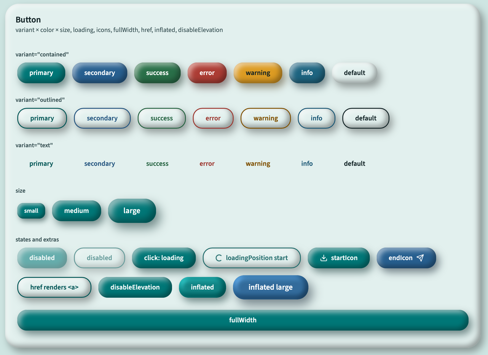

# claymo-ui

A claymorphic component library with Material UI-style APIs for Astro, Svelte 5, and Solid 2.



## Quick start

Use Node 22.23.4 (or later 22.x) or Node 24+, with npm 9.6.5+.

```sh
git clone https://github.com/selipso/claymo-ui.git && cd claymo-ui && npm install && npm start
```

Open <http://localhost:4321> for the docs. The [Solid demo](http://localhost:4321/demo/solid/) and [component gallery](http://localhost:4321/gallery/solid/) run the Solid 2 bridge; each component reference page also has a Solid tab.

## Packages

| Package                                                          | Purpose                                                |
| ---------------------------------------------------------------- | ------------------------------------------------------ |
| [`@claymo/core`](https://www.npmjs.com/package/@claymo/core)     | Styles, recipes, DOM behavior, and component reference |
| `@claymo/astro`                                                  | Astro components and `@claymo/astro/integration`       |
| [`@claymo/svelte`](https://www.npmjs.com/package/@claymo/svelte) | Svelte 5 components                                    |
| `@claymo/solid`                                                  | Solid 2 components for browser rendering and SSR       |
| [`@claymo/mcp`](https://www.npmjs.com/package/@claymo/mcp)       | Read-only MCP server for coding agents                 |
| `@claymo/playground`                                             | Documentation and demos (private)                      |

## Documentation

- [Overview](docs/index.md) — architecture, packages, and CSS techniques
- [Getting started](docs/getting-started.md) — playground, Astro, SvelteKit, and Solid 2 setup
- [Frameworks](docs/frameworks.md) — component conventions and MUI mappings
- [Theming](docs/theming.md) — CSS-only usage, palettes, and overrides
- [Motion](docs/motion.md) — motion presets, the `motion` prop, and tokens
- [MCP](docs/mcp.md) — client setup, tools, and the programmatic API
- [Accessibility](docs/accessibility.md) — behavior, limits, and verification coverage
- [Runbook](docs/RUNBOOK.md) — release verification and publishing

## License

[MIT](LICENSE) © 2026 claymo-ui contributors.
